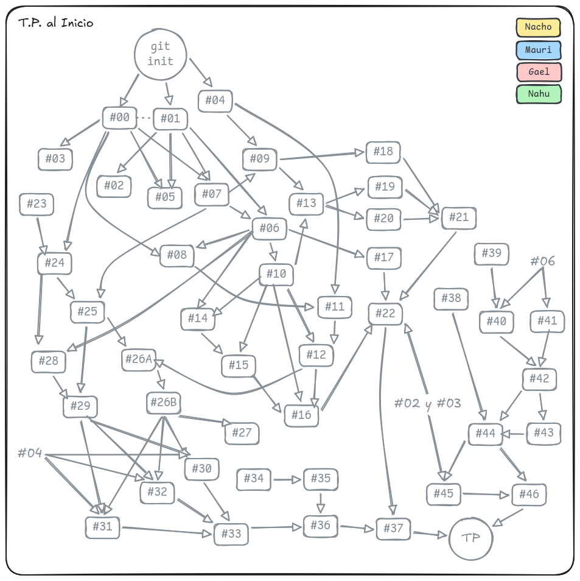
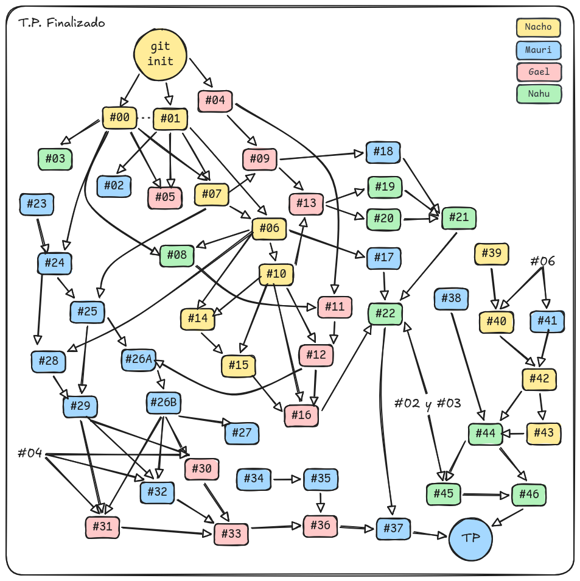

# Arimaa

Trabajo Práctico de Introducción a la Programación.

El objetivo de este trabajo es aplicar los conceptos de programación imperativa vistos en la materia para resolver ejercicios utilizando el lenguaje de programación **Python**. El trabajo consiste en implementar el juego **Arimaa**. Se trata de un juego de tablero diseñado por Omar Syed en 2002, con tres objetivos: (1) que sea posible jugar usando el tablero y las piezas de un juego de ajedrez común, (2) que las reglas sean suficientemente sencillas como para poder enseñarle a jugar a su hijo de cuatro años de edad, y (3) que el juego resulte difícil desde el punto de vista computacional

### Integrantes del Grupo:

- Ignacio Maldonado
- Mauricio Fernandez Diotti
- Gael Aquino
- Nahuel Macario

### Acerca de la Materia

- Introducción a la Programación (ex AyED I) 2c2026
- Plan de Estudio 2023 del Departamento de Computación, FCEyN, UBA

## Planificación del TP




## Comandos

### Coverage

[Documentación del Coverage](./doc/coverage.md)

1. Ejecutar los tests con coverage:

```Shell
PYTHONPATH=src python3 -m coverage run --branch -m unittest discover -s test
```

2. Generar el archivo JSON:

```Shell
python3 -m coverage json
```

3. Ejecutar tu script de cubrimiento

```Shell
python3 template/cubrimiento.py
```

### Generales

1. Para hacer chequeo de tipos del código:

```Shell
python -m mypy arimaa.py
```

2. Para correr los casos de test:

```Shell
python -m unittest test.tests.py
```

3. Para evaluar el cubrimiento del código por los casos de test:

```Shell
python -m coverage run --include arimaa.py --branch -m unittest test.tests.py
```

```Shell
python -m coverage json
```

```Shell
python cubrimiento.py
```

4. Para correr la interfaz gráfica:

```Shell
python interfaz.py
```

Para cargar el tablero desde el archivo especificado, se le puede pasar
como parámetro un nombre de archivo (p.ej. "tablero.txt").

Además, se aceptan las siguientes opciones:
-d Empieza el dorado.
-p Empieza el plateado.
-0 Empieza con 0 pasos consumidos.
-1 Empieza con un paso consumido.
-2 Empieza con dos pasos consumidos.
-3 Empieza con tres pasos consumidos.

Por ejemplo:

```Shell
python interfaz.py tablero.txt -p -1
```

Inicia el juego desde el tablero dado, donde comienzan las plateadas
que ya consumieron 1 paso (y por lo tanto le quedan tres pasos).

Nota: la interfaz gráfica sólo funcionará correctamente una vez que toda la
funcionalidad del TP se encuentre implementada. De lo contrario, pueden
experimentar comportamientos difíciles de predecir.

5. Formato de los archivos de tablero:

Los archivos de tablero deben ser de 8 líneas y 8 columnas.

Cada celda puede ser "-" (vacía) o una pieza.
Las letras mayúsculas representan piezas doradas y las minúsculas piezas plateadas:
E/e : Elephant (elefante)
M/m : Camel (camello)
H/h : Horse (caballo)
D/d : Dog (perro)
C/c : Cat (gato)
R/r : Rabit (conejo)

Por ejemplo:

```
rrrrrrrr
ccddhhme
--------
--------
--------
--------
EMHHDDCC
RRRRRRRR
```
